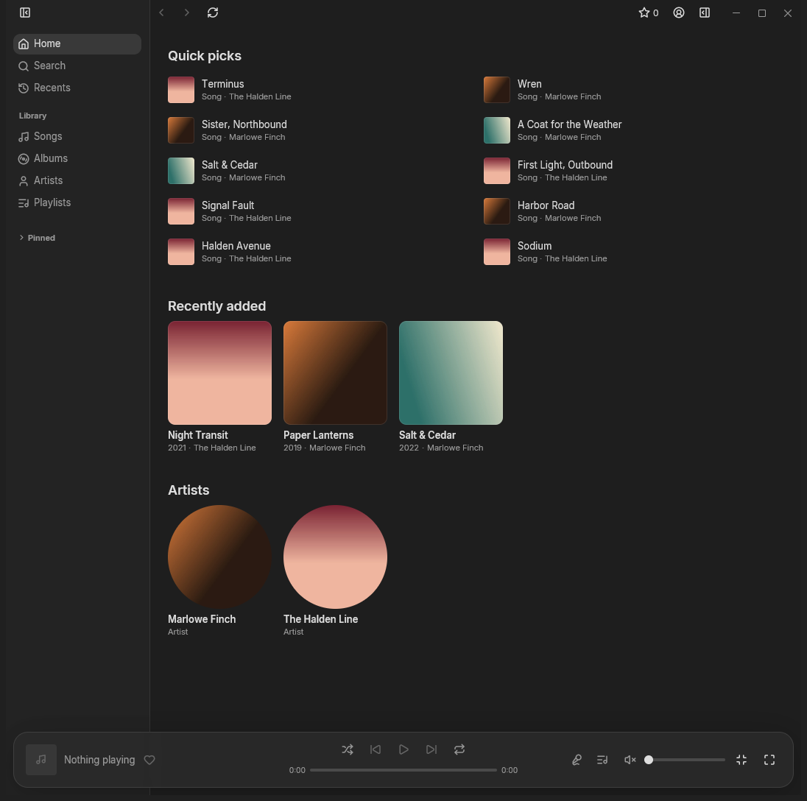
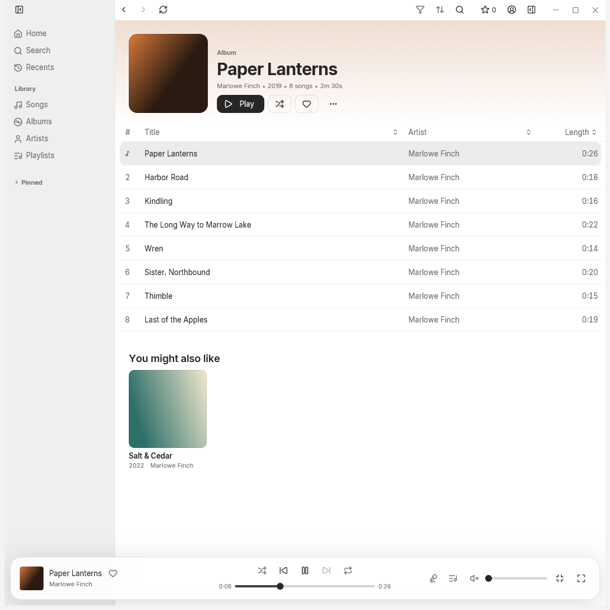
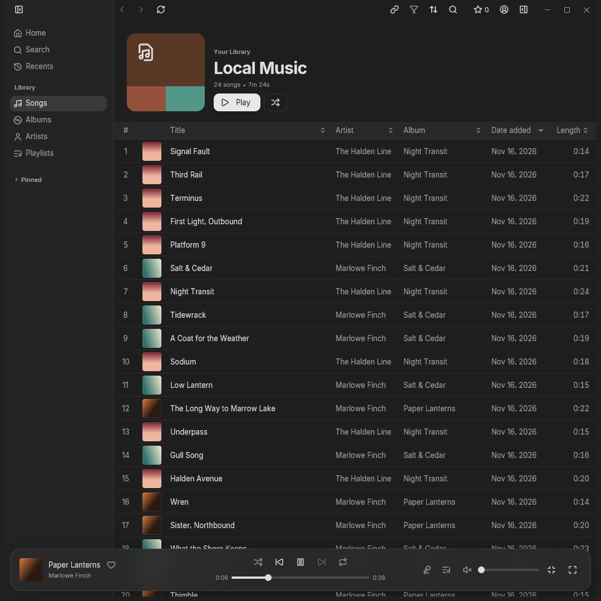
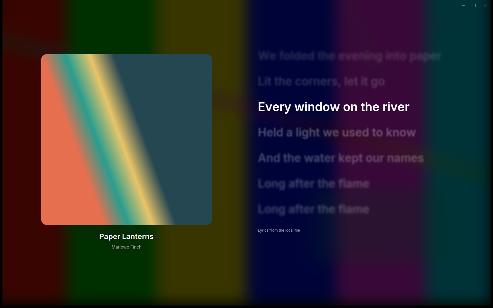
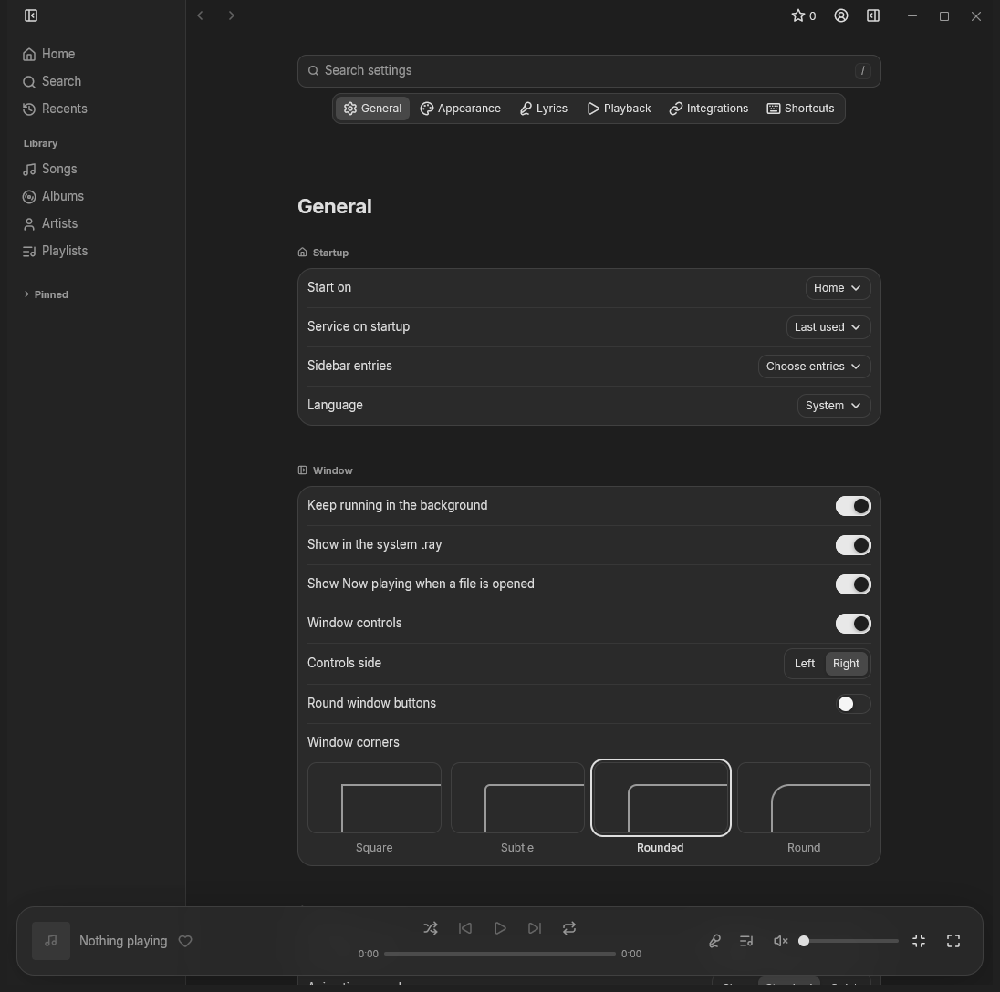

<p align="center"></p>

A native desktop music player for Windows, macOS and Linux, written in Rust
with GPUI. It plays your local files and streams from services you have an
account with, in one library.

Sonicly is free software under the GPL, version 3 or later. Its engine began as
a port of [Sonora](https://github.com/sonorahq/sonora); see `NOTICE.md`.



| | |
| --- | --- |
|  |  |
|  |  |

## What it does

- One library over local files and the services below, with quick search, a queue, and
  playlists you can import from M3U, PLS and XSPF files or split from a cue sheet.
- Now playing with synced lyrics you can style: a wave, fluid, cover, picture or video
  background, your own typeface, spacing and emphasis, saved as looks.
- A parametric equalizer, output device choice, a spectrum, and a sound chain that shows what
  each track passes through on its way out.
- A floating mini player, a tray icon, media keys, a command line, and `sonicly://` links.
- Download from a link with the yt-dlp you already have, into a music folder of yours.
- Drop a folder on the window to add it. The first run asks where your music comes from.

## What it plays

| Source | Needs |
| --- | --- |
| Local files (FLAC, MP3, AAC, ALAC, Opus, Vorbis, WAV, AIFF) | nothing |
| YouTube Music | nothing as a guest; sign in for your library |
| Spotify | a Premium account |
| Tidal | a Tidal account |
| Apple Music (Windows) | an Apple Music subscription |
| Subsonic / Navidrome, Jellyfin | your own server |

Sonicly does not circumvent DRM. Apple Music plays inside Apple's own web player, in a hidden
page of the system web view, so the equalizer, the visualizer and downloads do not apply to it.
Deezer is not supported.

## Build

Rust is pinned in `rust-toolchain.toml`; `rustup` installs it on first use. On
Windows you also need the MSVC build tools and the Windows SDK.

```sh
cargo run --package sonicly
scripts/check            # format, lints, tests, build
scripts/check --no-test  # the same without the test run
```

## Privacy and safety

Sonicly has no telemetry, no servers of its own, and cannot download or install anything
by itself. The one request it makes unasked is the repository's star count, at most once a
day, which Settings, About turns off. It
contacts only the music, lyrics, artwork and scrobbling services you use. Saved
logins are sealed with your Windows account's key. What Sonicly contacts and
stores is in `docs/PRIVACY.md`, and what was removed from the upstream code,
and why, in `docs/UPSTREAM.md`.

## Documents

- `docs/DESIGN.md` — every design decision and its reason
- `docs/PARITY.md` — each upstream feature and its status here
- `docs/PRIVACY.md` — what Sonicly contacts and what it stores
- `docs/BRAND.md` — the mark, colors and icon rules
- `docs/RESUME.md` — where work stands
